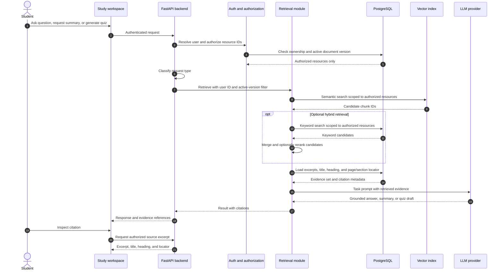
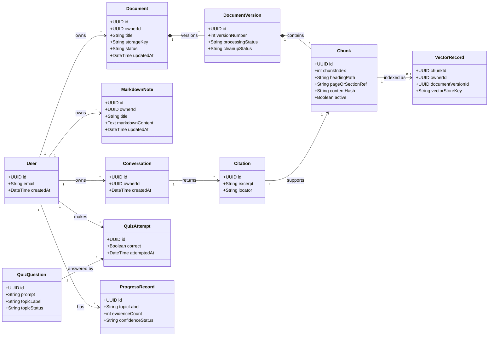
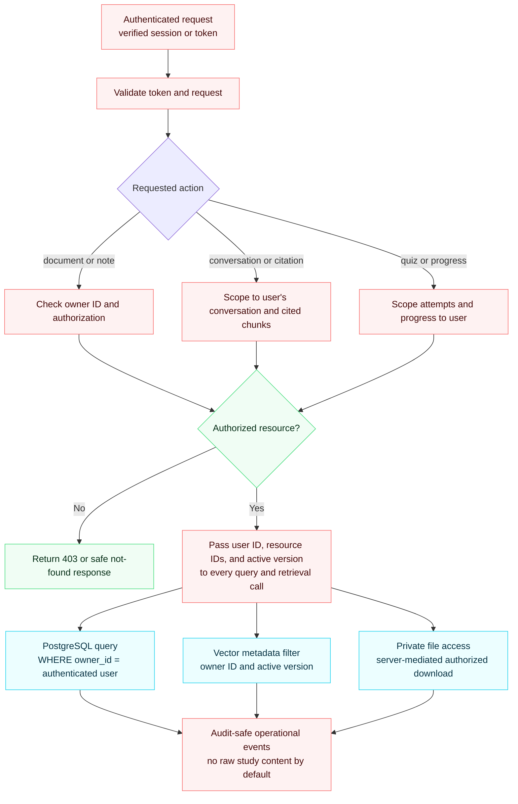
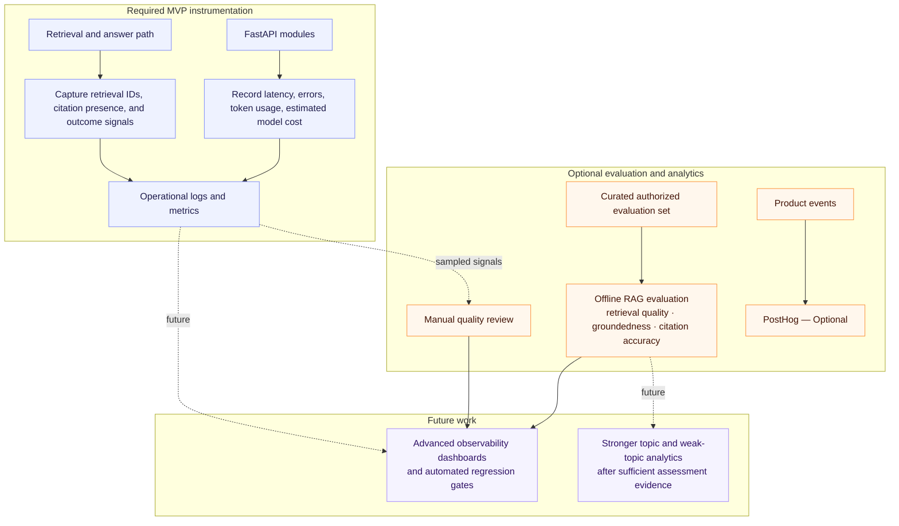
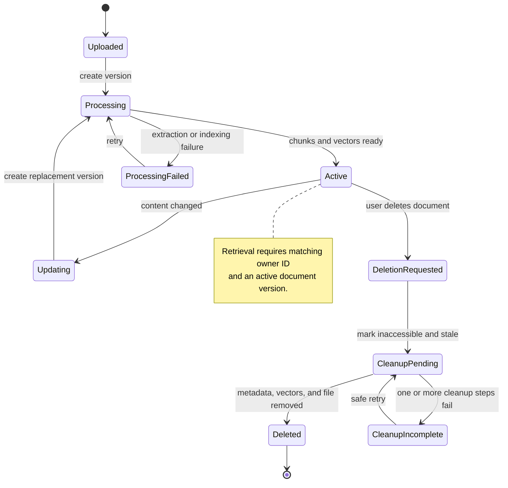

# Personal Study Assistant — Complete Mermaid Diagram Set

> **Legend:** Required MVP features are shown as solid paths. Optional and future items are explicitly labelled. The application remains one modular FastAPI backend rather than separate microservices.

## 1. End-to-end architecture and data flow

```mermaid
flowchart LR
    student@{ shape: person, label: "Student" }

    subgraph client ["Web client — Required MVP"]
        ui@{ shape: browser, label: "Study workspace\nDocuments · Markdown notes · chat · quizzes" }
        inspect["Evidence inspector\nexcerpt · heading · page/section"]
        ui --> inspect
    end

    subgraph api ["Single FastAPI backend — modular Required MVP"]
        auth["Authentication + authorization\nresolve authenticated user"]
        scope{"Authorized resource?"}
        docs["Document API\nupload · list · update · delete"]
        notes["Markdown Notes API\ncreate · edit · save · list · delete"]
        classify{"Request classifier\nquestion · summary · quiz"}
        answer["Answer service\ngrounded response + citations"]
        summary["Summarization service\ngrounded summary + citations"]
        quiz["Quiz service\ngenerate · grade · evidence-based explanation"]
        topic["Topic assignment\nmetadata, validated label, or Unclassified"]
        progress["Quiz attempts + progress\nno weak-topic claim with insufficient data"]
        lifecycle["Lifecycle coordinator\nversioning · invalidation · safe cleanup retry"]
        monitor["Operational monitoring\nlatency · tokens · estimated cost"]
    end

    subgraph ingest ["Document processing — Required MVP"]
        extract["Extract file or Markdown\npreserve title, headings, hierarchy, pages/sections"]
        chunk["Create versioned chunks\nowner ID · chunk index · source references"]
        embed["Embed chunks"]
    end

    subgraph retrieve ["Retrieval"]
        semantic["Semantic vector search — Required MVP\nowner + active-version filter"]
        keyword["Keyword search — Optional\nowner + active-version filter"]
        merge["Merge results — Optional"]
        rerank["Rerank results — Optional"]
        evidence["Evidence set\nexcerpts + metadata for citations"]
    end

    subgraph data ["Private data stores — Required MVP"]
        files@{ shape: folder, label: "Original file storage\nlocal private disk (dev) or object storage (prod)" }
        pg@{ shape: cyl, label: "PostgreSQL\nownership · metadata · notes · chunks · conversations\ncitations · quiz attempts · progress · cleanup status" }
        vectors@{ shape: cyl, label: "Vector index\nembeddings + user/document/version IDs" }
    end

    student --> ui
    ui -->|authenticated request| auth --> scope
    scope -->|allowed| docs & notes & classify
    scope -->|denied| ui

    docs --> files & pg
    notes --> pg
    docs --> extract
    notes --> extract
    extract --> chunk --> embed --> vectors
    chunk --> pg

    classify --> semantic
    semantic -. Optional .-> keyword
    semantic -. Optional .-> merge
    keyword -.-> merge
    merge -. Optional .-> rerank
    semantic --> evidence
    merge -.-> evidence
    rerank -.-> evidence

    evidence --> answer & summary & quiz
    quiz --> topic --> pg
    quiz --> progress --> pg
    answer & summary & quiz --> ui
    evidence --> inspect

    docs -->|update or delete| lifecycle
    lifecycle --> files & pg & vectors
    auth --> monitor
    semantic --> monitor
    answer & summary & quiz --> monitor

    classDef required fill:#eef2ff,stroke:#818cf8,color:#1e1b4b
    classDef security fill:#fef2f2,stroke:#f87171,color:#450a0a
    classDef data fill:#f0fdfa,stroke:#2dd4bf,color:#042f2e
    classDef optional fill:#fff7ed,stroke:#fb923c,color:#431407
    class ui,inspect,docs,notes,classify,answer,summary,quiz,topic,progress,lifecycle,extract,chunk,embed,semantic,evidence,monitor required
    class auth,scope security
    class files,pg,vectors data
    class keyword,merge,rerank optional
```

## 2. Backend component design

```mermaid
flowchart TB
    web@{ shape: browser, label: "Study workspace" }

    subgraph backend ["Single FastAPI backend — Required MVP"]
        auth["Auth and authorization\nresolve user and resource scope"]
        documentApi["Document module\nupload · list · update · delete"]
        noteApi["Markdown Notes module\ncreate · edit · save · list · delete"]
        conversation["Conversation module\nmessages and citations"]
        classifier{"Request classifier"}
        answer["Question-answering service"]
        summary["Summarization service"]
        quiz["Quiz service\ngenerate · grade · explain from evidence"]
        topic["Topic module\nmetadata, validated label, or Unclassified"]
        progress["Progress module\nrecord attempts and assessment sufficiency"]
        lifecycle["Lifecycle coordinator\nversioning and cleanup recovery"]
        retrieval["Retrieval module\nsemantic MVP; hybrid/reranking optional"]
    end

    web --> auth
    auth --> documentApi & noteApi & conversation & classifier
    classifier -->|question| answer
    classifier -->|summary| summary
    classifier -->|quiz request| quiz
    answer & summary & quiz --> retrieval
    quiz --> topic --> progress
    documentApi --> lifecycle

    classDef core fill:#eef2ff,stroke:#818cf8,color:#1e1b4b
    classDef security fill:#fef2f2,stroke:#f87171,color:#450a0a
    classDef decision fill:#fefce8,stroke:#facc15,color:#422006
    class auth security
    class classifier decision
    class web,documentApi,noteApi,conversation,answer,summary,quiz,topic,progress,lifecycle,retrieval core
```

## 3. RAG request sequence and evidence inspection



## 4. Domain and database class model



## 5. Document ingestion, retrieval, update, and deletion data flow

```mermaid
flowchart LR
    source["Uploaded document or saved Markdown note"] --> extract["Extract content\npreserve title, headings, hierarchy, pages/sections"]
    extract --> version["Create document version"]
    version --> chunks["Create indexed chunks\nowner ID · heading path · locator · chunk index"]
    chunks --> pg@{ shape: cyl, label: "PostgreSQL metadata" }
    chunks --> embed["Create embeddings"]
    embed --> vectors@{ shape: cyl, label: "Vector index" }
    source --> originals@{ shape: folder, label: "Original file storage" }

    query["Authorized user request"] --> filter["Apply owner and active-version filter"]
    filter --> semantic["Semantic search — MVP"]
    filter -. Optional .-> keyword["Keyword search"]
    semantic --> evidence["Evidence set and citations"]
    keyword -. Optional merge .-> merge["Merge and optional rerank"]
    semantic -. Optional merge .-> merge
    merge -.-> evidence
    evidence --> response["Grounded answer, summary, or quiz explanation"]

    update["Update or delete document"] --> lifecycle["Mark old version stale\nqueue rebuild or cleanup"]
    lifecycle --> pg & vectors & originals
    lifecycle --> recovery["Retry incomplete cleanup safely\nretain audit status"]

    classDef required fill:#f0fdfa,stroke:#2dd4bf,color:#042f2e
    classDef optional fill:#fff7ed,stroke:#fb923c,color:#431407
    classDef storage fill:#eef2ff,stroke:#818cf8,color:#1e1b4b
    class source,extract,version,chunks,embed,query,filter,semantic,evidence,response,update,lifecycle,recovery required
    class keyword,merge optional
    class pg,vectors,originals storage
```

## 6. Security and user-isolation flow



## 7. Evaluation and operational monitoring



## 8. Document lifecycle state model



## 9. Development and production deployment

